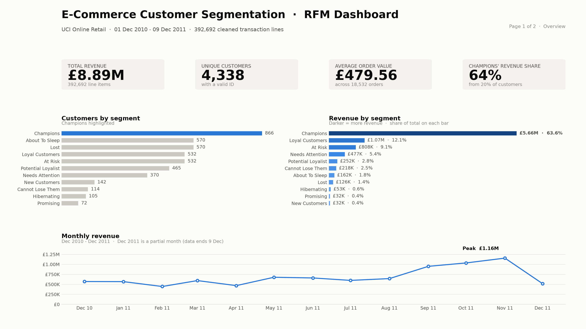
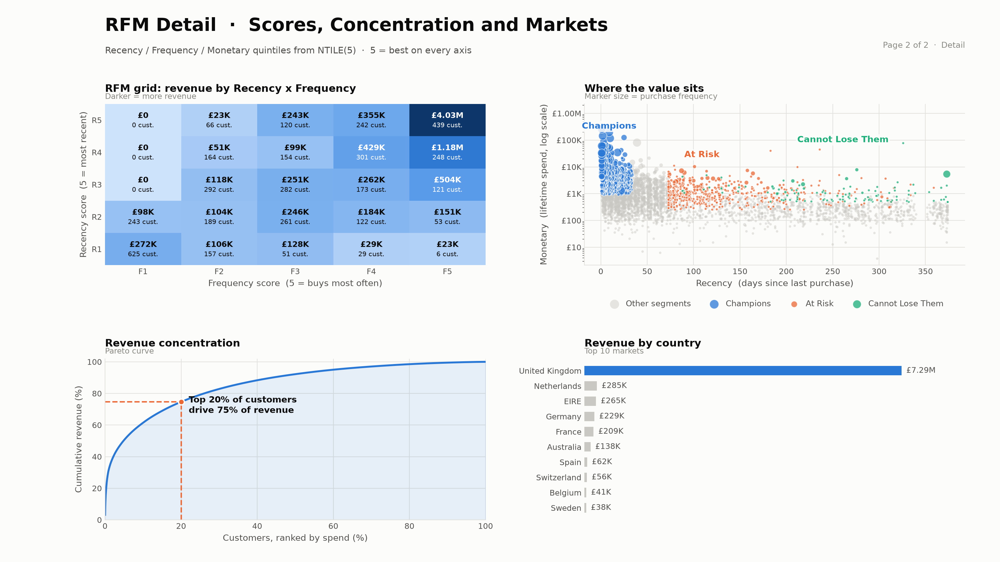
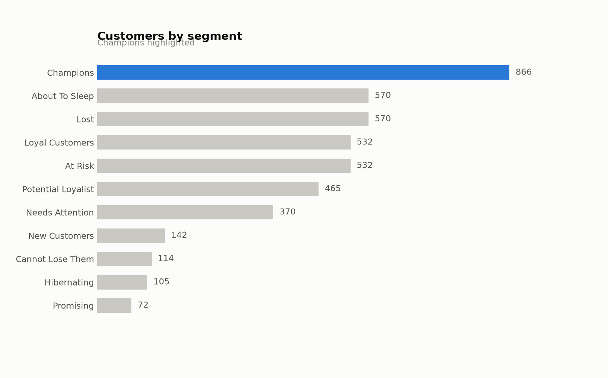
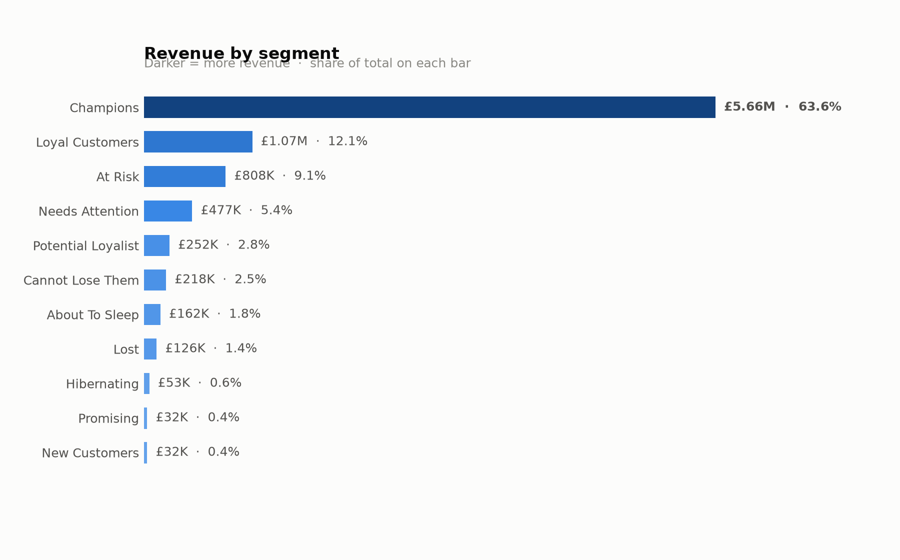
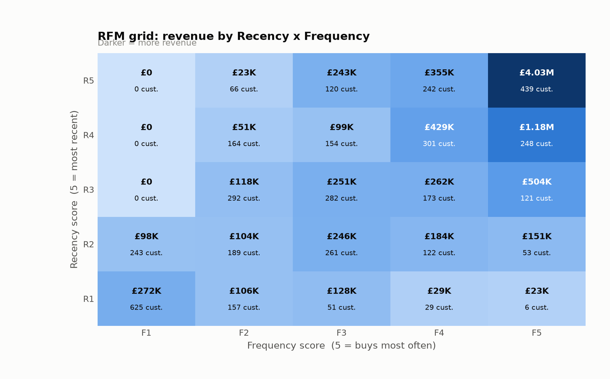
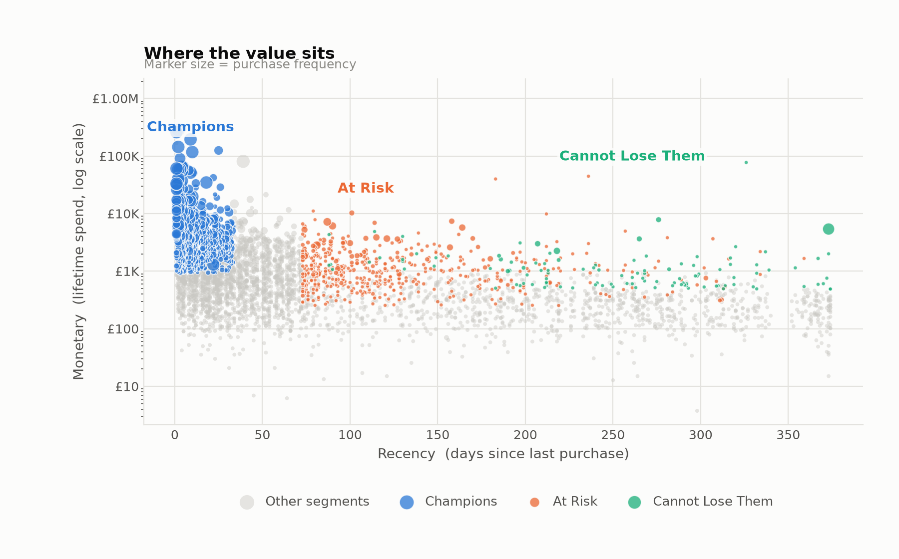
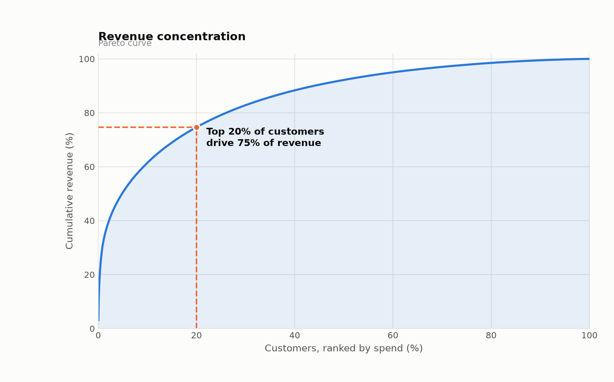
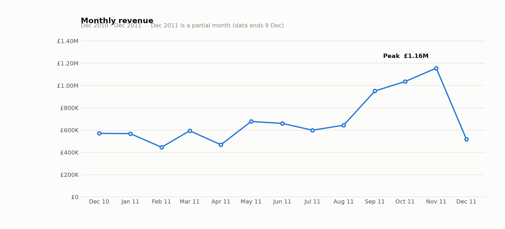

# E-Commerce Customer Segmentation — RFM Analysis

Customer segmentation on **541,909 raw transactions** (UCI Online Retail, Dec 2010 – Dec 2011),
built end-to-end in **Python → PostgreSQL → Power BI**.




📄 **[Case study — 2-page PDF](reports/rfm_case_study.pdf)**  ·  **[Full dashboard as PDF](reports/rfm_dashboard.pdf)**

---

## Headline findings

| Metric | Value |
|---|---|
| Total revenue | £8.89M |
| Unique customers | 4,338 |
| Average order value | £479.56 |
| **Champions** | 20% of customers → **64% of revenue** |
| Revenue concentration | Top 20% of customers → 75% of revenue |
| At Risk + Cannot Lose Them | 646 customers holding £1.03M of historic spend |

The business case writes itself: retention spend belongs on the 866 Champions and the
646 lapsing high-value customers, not on blanket discounting.

## Pipeline

| Stage | File | What it does |
|---|---|---|
| 1. Clean | [`data_cleaning.py`](data_cleaning.py) | Drops duplicates, null `CustomerID`, cancelled orders (`C`-prefix) and non-positive quantity/price; derives `Total_Price`. 541,909 → **392,692** rows. |
| 2. Model | [`rfm_model.sql`](rfm_model.sql) | PostgreSQL CTEs + `NTILE(5)` window functions → Recency, Frequency, Monetary quintiles, a 3-digit `rfm_score`, and an 11-way `customer_segment`. |
| 3. Visualise | [`power_bi_dax.txt`](power_bi_dax.txt) · [`generate_dashboard.py`](generate_dashboard.py) | DAX measures and segmentation column for Power BI; matplotlib renderer for the static PNG/PDF versions above. |
| 4. Report | [`generate_report.py`](generate_report.py) | Builds the two-page case-study PDF from the same numbers — every figure in it is computed, not typed. |

### Scoring logic

Recency is scored `NTILE(5) OVER (ORDER BY recency DESC)` so **5 = most recent**;
frequency and monetary ascend so 5 = best on every axis. The snapshot date is
`MAX(invoice_date) + 1 day`, so the most recent buyer scores 1 day rather than 0.

## Visuals

| | |
|---|---|
|  |  |
|  |  |
|  |  |

## Reproduce

```bash
pip install -r requirements.txt

# 1. Dataset -> data/raw/  (https://archive.ics.uci.edu/dataset/352/online+retail)
python -c "import pandas as pd; pd.read_excel('data/raw/Online Retail.xlsx', \
  dtype={'InvoiceNo':str,'StockCode':str}).to_csv('data/raw/online_retail.csv', index=False)"

# 2. Clean
python data_cleaning.py --input data/raw/online_retail.csv \
                        --output data/clean/online_retail_clean.csv

# 3. Model  (edit the COPY path, or use \copy from psql)
psql -d retail_analytics -f rfm_model.sql

# 4. Dashboard images and the case-study PDF
python generate_dashboard.py
python generate_report.py --author "Your Full Name" --github "github.com/you/repo"
```

Power BI: import `vw_rfm_segments` and `vw_sales_fact`, relate on `customer_id`,
then paste the measures from `power_bi_dax.txt`.
